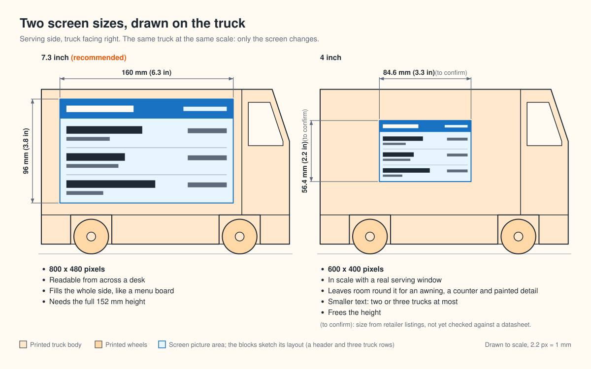

# Desk food truck: the build plan

## 1. What you're building

A 3D-printed food truck for your desk, 229 x 127 x 152 mm (9 x 5 x 6 in). The whole serving side is a 7.3 inch
colour e-paper screen that shows which food trucks are outside the office today. It wakes once each weekday morning,
fetches a fresh picture over Wi-Fi, redraws, and sleeps again. On a 2500 mAh battery that should mean charging it
**about once a year** (an estimate, checked on the bench before the truck is closed up).

Who does what:

- **You:** model and print the truck, buy the parts, solder (if you pick a soldering route), assemble.
- **The crew (me):** all the software, in this repo: the job that reads the truck page, the web page, the picture
  for the screen, and the program on the board. You get it ready to load, and you approve how the screen looks.

One thing differs from what you asked for. You said "a screen that shows a webpage". A live browser needs a
computer and a backlit screen, which empties a large battery in about 12 hours. So the truck shows a **picture of
your web page**, taken fresh each morning. The page itself is real and anyone can open it on a phone.

## 2. How it works

A job in the cloud does the heavy work each morning, so the truck only has to download one small picture.

The truck is asleep for all but about 40 seconds of a working day, and the screen keeps its picture with no power
at all. That is where the year of battery life comes from.

Each time it wakes it runs the same short routine, and every path through it ends back in deep sleep:

Details worth knowing:

- **The cloud decides the schedule.** Each morning's files tell the truck how long to sleep, so weekends, holidays
  or a different wake time never need the truck opened or reloaded.
- **A stale screen shows itself.** The date is printed large on every picture.
- **The reset button means "refresh now".**
- **Hosting is free:** the job runs on GitHub Actions and the files sit on GitHub Pages. That needs a GitHub repo
  for this project, which I will only create on your word (it is one of the questions at the end).

## 3. What the screen shows

800 x 480 pixels in six flat colours: black, white, red, yellow, blue and green. Bold type and flat colour look
crisp on this screen; photos and gradients turn grainy, so the page is designed like a menu board.

This layout is a first sketch. Once the software exists you will judge the real page on Review Desk, in the
screen's true colours, before anything is loaded onto the truck.

**Screen size is your call.** The 7.3 inch screen fills the side and reads from across a desk. The 4 inch version
of the same screen is closer to the scale of a real serving window and leaves wall for an awning and painted detail,
but holds less and has smaller text. The plan assumes 7.3 inch; say so at the end if you want the 4 inch.

## 4. Battery: about a year per charge

| What drains the battery | mAh per day |
|---|---|
| The battery's own self-discharge (3% a month) | 2.47 |
| The board asleep, all day (15 µA) | 0.36 |
| Waking and redrawing, weekdays (estimate) | 0.57 |
| **Total** | **3.40, so about 588 days: 19 months** |

What this means for the build:

- **The battery mostly drains itself.** The electronics use about a quarter of the total. A bigger battery buys
  little, because self-discharge grows with it. 2500 mAh is plenty.
- **One step matters more than everything else:** the board must sleep properly. On the recommended board that is a
  single knife cut on a marked pad. Skip it and a charge lasts about 4 months.
- **These are estimates.** The sleep figure is measured; the cost of one redraw on this screen is not published
  anywhere, so I estimated it, and the chart shows a worst case too (14 months). You measure the real thing in
  phase 4.

## 5. Three ways to build the electronics

You asked for all three. The screen, the truck and the software are the same in each; only the boards and the
amount of soldering change.

| | A: plug together | B: a little soldering | C: solder everything |
|---|---|---|---|
| Soldering | none | two rows of header pins | eight wires, battery leads, two resistors, a switch |
| Main board | Seeed XIAO ePaper Display Board EE04 | DFRobot FireBeetle 2 ESP32-E | Seeed XIAO ESP32-S3 |
| Asleep, whole board | not published | 11.6 µA, measured | 12 to 13 µA, measured |
| Cost | about $85 | about $105, plus $45 of soldering kit | about $90, plus $45 of soldering kit |
| Main unknown | battery life is unproven | whether the screen's adapter leaks while asleep | fine soldering on small pads |

**I recommend route B.** You said you would love to learn to solder, and header pins are the classic first job:
large, forgiving, all the same. The board has a measured, very low sleep current, so the year of battery life rests
on something known. Route A is the fallback if soldering turns out not to be fun: it reuses the same screen and
battery, so switching costs about $10. Route C makes a neat second build once route B's joints feel easy.

For routes B and C, eight wires join the screen's adapter to the main board:

**Before the first plug-in on any route:** check that the battery's red wire meets the board's + mark. Battery
makers disagree about which side is +, and a reversed battery destroys the board.

## 6. The truck: sizes to model to

These are target numbers, worked out from the screen's datasheet drawing. Measure the real parts before you model
(phase 5); the real parts win.

**Height is the tight one.** The screen's glass is 111.2 mm tall and stands upright in the wall, with the wheels
under it and the roof over it. 152 mm works with 32 mm wheels, but with only about 1 mm spare above and below the
glass. **I recommend 155 mm (6.1 in).** These drawings are for 152 mm; once you pick the height and the screen size
at the end of this page, I reissue the mechanical drawings to match.

Most of the truck is empty. The electronics take a slab about 35 mm deep behind the serving wall; the rest is yours
for structure, weight or nothing.

Three rules for the window:

- **The glass never touches the wall.** Leave a 0.5 mm air gap. Nothing clamps or presses the glass.
- **Chamfer the window's edges outward**, so the wall never shades the picture when you look down at it.
- **The opening is 161 x 97 mm at the wall's inner face,** half a millimetre bigger all round than the picture.

## 7. The sled and the printed parts

Everything electrical lives on one removable printed plate, the **sled**. You build and test it on the bench as a
complete working unit before any truck exists. Then it drops into the truck from the top with the roof off. The
truck is plain plastic: reprint it, repaint it or redesign it without touching the electronics.

Printing notes:

- **Bed size.** The body is 229 mm long. It fits a 250 or 256 mm bed; on a 220 mm bed, split it just in front of
  the sled, at the cab.
- **The window's top edge** is a 161 mm bridge if the body prints upright. Print with supports in the window, or
  print the serving wall as its own flat part (the flattest result for the screen), or lay the body on its far side.
- **Print a test slice first:** 20 mm of the serving wall with the window and the two channels. Try the sled in it
  before committing to the full print.
- **Charging.** The main board's USB-C port lines up with a slot in the rear wall, so you charge it like a phone,
  roof on. On route A the port may not reach; once a year, lifting the roof to charge is no hardship.

## 8. Shopping list

Prices are approximate for November 2026. Waveshare's own site would not load, so its prices are from resellers.

**Every route**

| Part | About |
|---|---|
| 2500 mAh protected LiPo battery with a 2 mm JST plug (Adafruit #328 or similar) | $15 |
| Eight magnets, 6 mm x 3 mm | $5 |
| M2.5 x 6 screws, thin double-sided tape, 1 mm foam tape | $8 |
| A basic multimeter (checks battery polarity, and measures the sleep current in phase 4) | $20 |

**Route A**

| Part | About |
|---|---|
| Bare 7.3 inch Spectra 6 panel (Waveshare 7.3inch e-Paper (E), raw panel) | $60 |
| Seeed Studio XIAO ePaper Display Board EE04 (check it ships with its Wi-Fi board already soldered on) | $10 |

**Route B (recommended)**

| Part | About |
|---|---|
| Waveshare 7.3inch e-Paper HAT (E) set: the screen, its adapter and an 8-wire cable | $80 |
| DFRobot FireBeetle 2 ESP32-E | $9 |
| Soldering kit: adjustable iron (a Pinecil or any 60 W), 0.8 mm rosin-core solder, brass wool, silicone mat, helping hands, safety glasses, flush cutters, a through-hole practice kit | $45 |

**Route C**

| Part | About |
|---|---|
| Bare 7.3 inch Spectra 6 panel | $60 |
| Good Display DESPI-C73 adapter | price not listed |
| Seeed XIAO ESP32-S3 | $7.50 |
| Two 1 MΩ resistors, a slide switch, thin wire | $5 |
| The same soldering kit | $45 |

A finished unit also exists (Seeed reTerminal E1002, $99: this screen, a battery and a board in a metal case). I do
not recommend it: its case needs a truck about 160 mm tall, and nobody has published its battery life at one
redraw a day.

## 9. Learning to solder

For routes B and C. Do the practice kit first; the real board comes after ten joints you are happy with.

- **Hold the pins square** by pushing them into a breadboard, or blu-tack, before you solder the board onto them.
- **Solder one corner pin, check the board sits flat, then do the rest.**
- **Never solder with the battery plugged in.**

## 10. The build, in order

Two rules of order: **don't model before the parts are in your hands**, and **don't close the truck before it has
run a week on the bench**.

**Phase 0. Decide and order (you).**
1. Answer the questions at the end of this page.
2. Send me the link to the page that lists the trucks.
3. Check the office Wi-Fi has a 2.4 GHz band (these boards cannot use 5 GHz), and that a home-made gadget is
   allowed on it. A quick word with whoever runs the network settles both.
4. Order the parts for your route.

**Phase 1. Software (the crew, while your parts ship).**
1. The job that reads the truck page and picks out today's trucks.
2. The web page, laid out for the screen.
3. The renderer: page to screenshot to six-colour picture.
4. The morning schedule, publishing to a fixed web address.
5. The program for your route's board.
Gate: today's trucks show at the web address, and you approve the look on Review Desk.

**Phase 2. Learn to solder (you; routes B and C).**
1. Build the practice kit. Aim for ten clean joints.
2. Solder the two rows of header pins onto the FireBeetle.
3. Cut the low-power pad with a craft knife (it is marked on the board; I will show you exactly where).

**Phase 3. Bench build (you, with me on call).**
1. Lay the parts out on the desk. Leave the screen's protective film on.
2. Plug the screen's ribbon into the adapter: lift the socket's latch, slide the ribbon in square, close the latch.
   Never with power connected.
3. Connect the eight wires by the pin map.
4. Check the battery's polarity with the multimeter, then plug it in.
5. Load the program over USB-C (one command, which I will give you) and enter the Wi-Fi name and password.
Gate: the bare screen shows today's trucks, running from the battery alone.

**Phase 4. Power check (both).**
1. With the multimeter in line with the battery, read the current while the truck sleeps. Expect about 15 µA
   (0.015 mA). Hundreds of µA means something is still awake; we find it before going on.
2. Leave it running on the bench for a week. It redraws every morning.
Gate: sleep current under 50 µA, and seven mornings of correct pictures.

**Phase 5. Model (you).**
1. Measure the real screen, boards and battery with calipers.
2. Model and print the sled. Mount the electronics on it. It should work exactly as it did loose on the bench.
3. Model the truck around the sled, to the numbers in section 6.
4. Print the test slice of the serving wall and try the sled in it.

**Phase 6. Print and assemble (you).**
1. Print the chassis, body, roof and wheels. Paint before the electronics go in.
2. Drop the sled in, peel the screen's film, put the roof on.
Gate: it updates from inside the closed truck, on the desk where it will live.

**Phase 7. Live with it (both).** Two weeks on the desk. We tune the layout, the wake time and anything that
annoys you.

## 11. What could go wrong

| Risk | What we do about it |
|---|---|
| The office Wi-Fi has no 2.4 GHz band, or does not allow gadgets | Checked in phase 0, before you buy anything. |
| The truck page changes its layout and the job cannot read it | The screen says so plainly instead of showing old trucks, and GitHub emails me that the job failed. |
| The cloud job runs late (GitHub's schedule can slip by half an hour) | The truck checks the picture's date; if it is yesterday's, it tries again in 30 minutes. |
| Battery life is shorter than estimated | Measured in phase 4 while everything is still on the bench. The fixes are known: the low-power pad, or a passive adapter for the screen. |
| The glass cracks | Nothing clamps it, the film stays on until the end, and the sled keeps it supported from the bench to the truck. |
| Faint ghost images after a weekend | The screen's maker advises a redraw every 24 hours; weekends go 72. If ghosts appear, the truck redraws at weekends too, which costs about five weeks of battery life per charge. |
| Sun and heat | Keep it out of direct sun: the screen degrades in it and PLA softens. The screen works from 0 to 50 °C. |
| The battery | A protected cell in a pocket with room to swell, never clamped, away from screw points. Charge it while you are around. |
| Parts turn out different from the datasheet | You measure the real parts before modelling, and print a test slice before the full truck. |

## 12. What is still open

- **The link** to the page that lists the trucks. Everything in phase 1 starts from it.
- **Your answers** to the questions below: the route, the screen size, your printer's bed, the height, and whether I
  may create a GitHub repo for the job and the page.
- **Three facts nobody publishes,** each settled on the bench: the energy one redraw costs on this screen; route A's
  sleep current; and whether Waveshare's adapter draws current while asleep.
