# Desk food truck: the build plan

## 1. What you're building

A 3D-printed food truck for your desk, 229 x 127 x 155 mm (9 x 5 x 6.1 in). The whole serving side is a 7.3 inch
colour e-paper screen that shows which food trucks are outside the office today. It wakes once each weekday morning,
fetches a fresh picture over Wi-Fi, redraws, and sleeps again. On a 2500 mAh battery that should mean charging it
**about once a year** (an estimate, checked on the bench before the truck is closed up).

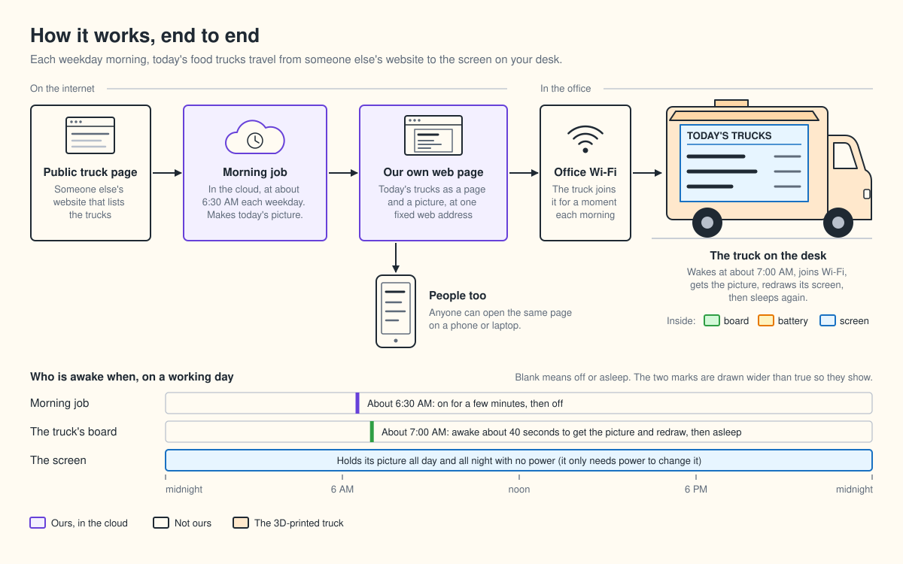

Who does what:

- **You:** model and print the truck, buy the parts, solder (if you pick a soldering route), assemble.
- **The crew (me):** all the software, in this repo: the job that reads the truck page, the web page, the picture
  for the screen, and the program on the board. You get it ready to load, and you approve how the screen looks.

One thing differs from what you asked for. You said "a screen that shows a webpage". A live browser needs a
computer and a backlit screen, which empties a large battery in about 12 hours. So the truck shows a **picture of
your web page**, taken fresh each morning. The page itself is real and anyone can open it on a phone.

## 2. How it works

A job in the cloud does the heavy work each morning, so the truck only has to download one small picture.

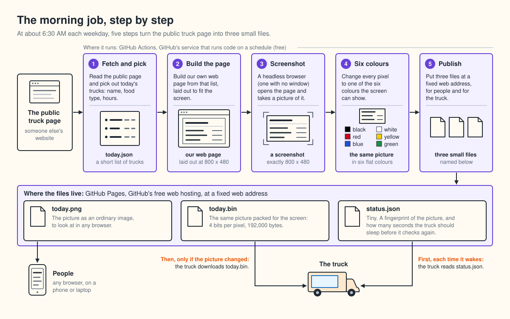

The truck is asleep for all but about 40 seconds of a working day, and the screen keeps its picture with no power
at all. That is where the year of battery life comes from.

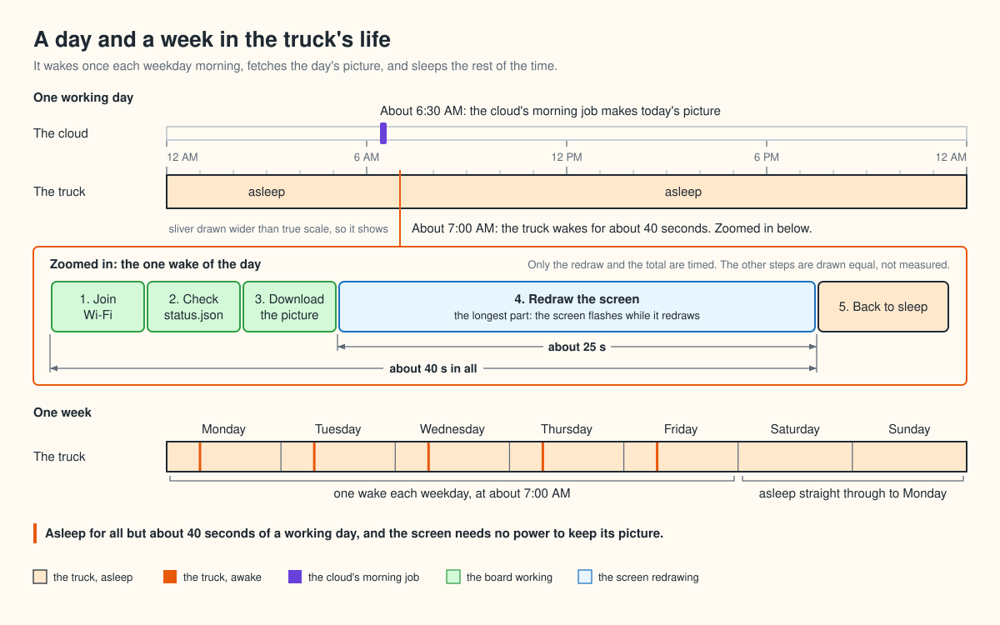

Each time it wakes it runs the same short routine, and every path through it ends back in deep sleep:

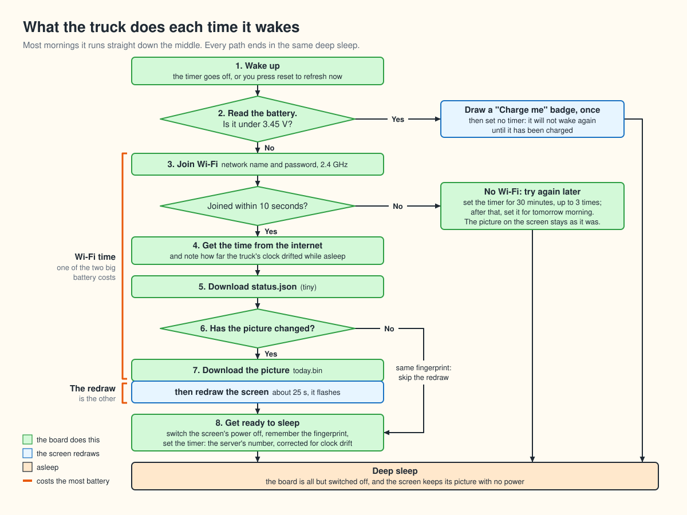

Details worth knowing:

- **The cloud decides the schedule.** Each morning's files tell the truck how long to sleep, so weekends, holidays
  or a different wake time never need the truck opened or reloaded.
- **A stale screen shows itself.** The date is printed large on every picture.
- **The reset button means "refresh now".**
- **Hosting is free:** the job runs on GitHub Actions and the files sit on GitHub Pages. The project's repo is
  `github.com/AidanBarciaBacon/foodTruck`, private. Free Pages needs a public repo, so when the software is ready
  you choose: make the repo public, or host the three small files somewhere else.
- **The truck list** comes from Off the Grid's page for Levi's Plaza.

## 3. What the screen shows

800 x 480 pixels in six flat colours: black, white, red, yellow, blue and green. Bold type and flat colour look
crisp on this screen; photos and gradients turn grainy, so the page is designed like a menu board.

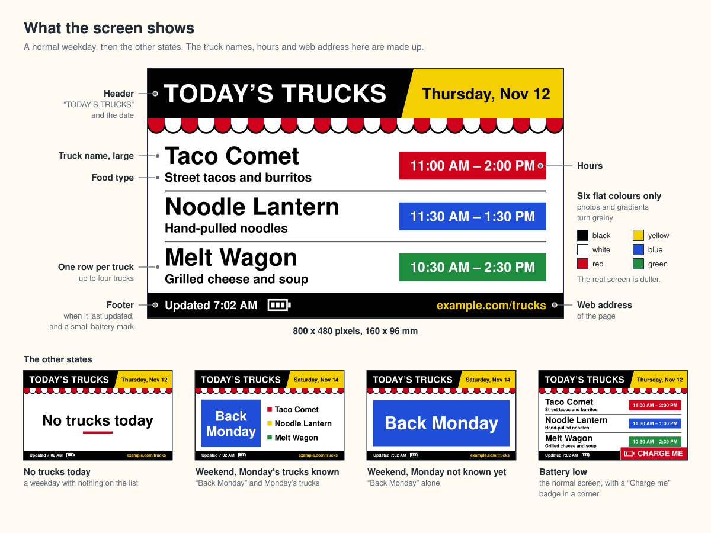

This layout is a first sketch, and it stays one for now. You said the page's design gets real work later, once
the hardware is up and running; until then it only has to be correct and readable.

## 4. Battery: about a year per charge

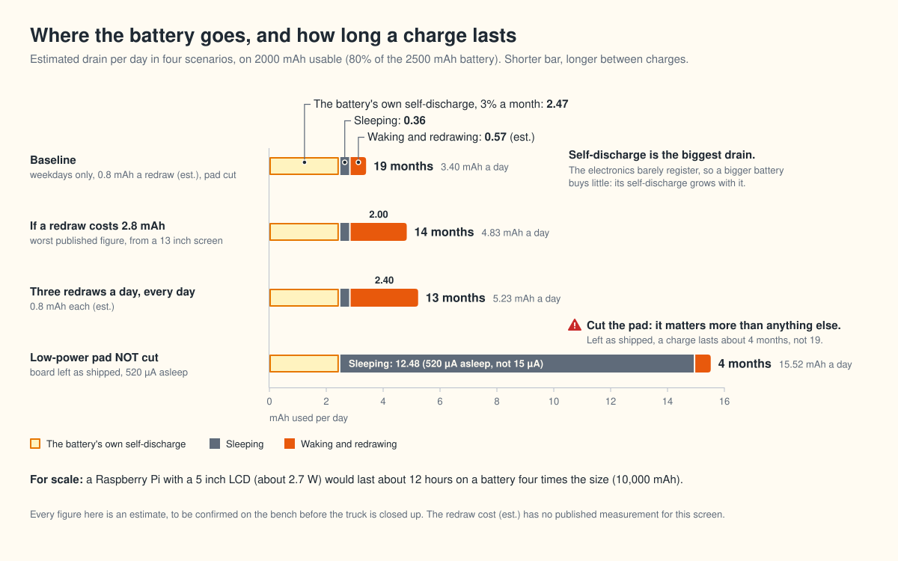

| What drains the battery | mAh per day |
|---|---|
| The battery's own self-discharge (3% a month) | 2.47 |
| The board asleep, all day (15 µA) | 0.36 |
| Waking and redrawing, weekdays (estimate) | 0.57 |
| **Total** | **3.40, so about 588 days: 19 months** |

What this means for the build:

- **The battery mostly drains itself.** The electronics use about a quarter of the total. A bigger battery buys
  little, because self-discharge grows with it. 2500 mAh is plenty.
- **One step matters more than everything else:** the board must sleep properly. On the recommended board that is a
  single knife cut on a marked pad. Skip it and a charge lasts about 4 months.
- **These are estimates.** The sleep figure is measured; the cost of one redraw on this screen is not published
  anywhere, so I estimated it, and the chart shows a worst case too (14 months). You measure the real thing in
  phase 4.

## 5. Three ways to build the electronics

You asked for all three. The screen, the truck and the software are the same in each; only the boards and the
amount of soldering change.

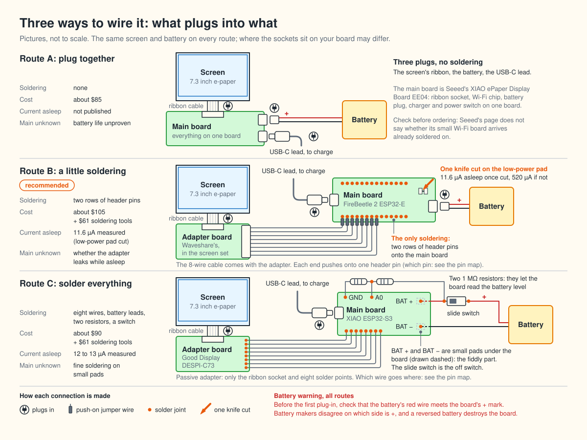

| | A: plug together | B: a little soldering | C: solder everything |
|---|---|---|---|
| Soldering | none | two rows of header pins | eight wires, battery leads, two resistors, a switch |
| Main board | Seeed XIAO ePaper Display Board EE04 | DFRobot FireBeetle 2 ESP32-E | Seeed XIAO ESP32-S3 |
| Asleep, whole board | not published | 11.6 µA, measured | 12 to 13 µA, measured |
| Cost | about $85 | about $105, plus $61 of soldering tools | about $90, plus $61 of soldering tools |
| Main unknown | battery life is unproven | whether the screen's adapter leaks while asleep | fine soldering on small pads |

**You chose route B.** You said you would love to learn to solder, and header pins are the classic first job:
large, forgiving, all the same. The board has a measured, very low sleep current, so the year of battery life rests
on something known. Route A is the fallback if soldering turns out not to be fun: it reuses the same screen and
battery, so switching costs about $10. Route C makes a neat second build once route B's joints feel easy.

For routes B and C, eight wires join the screen's adapter to the main board:

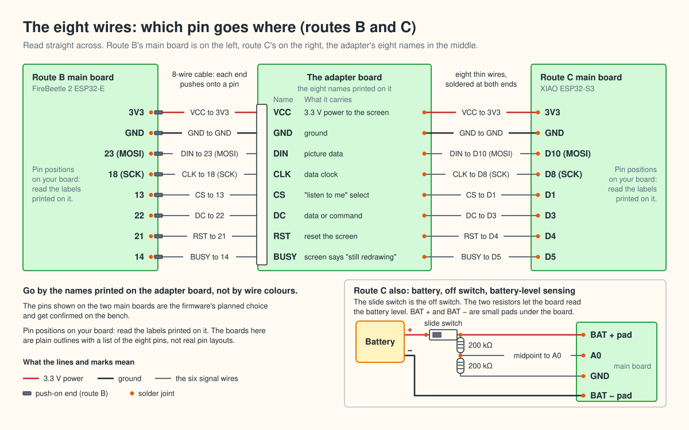

**Before the first plug-in on any route:** check that the battery's red wire meets the board's + mark. Battery
makers disagree about which side is +, and a reversed battery destroys the board.

## 6. The truck: sizes to model to

These are target numbers, worked out from the screen's datasheet drawing. Measure the real parts before you model
(phase 5); the real parts win.

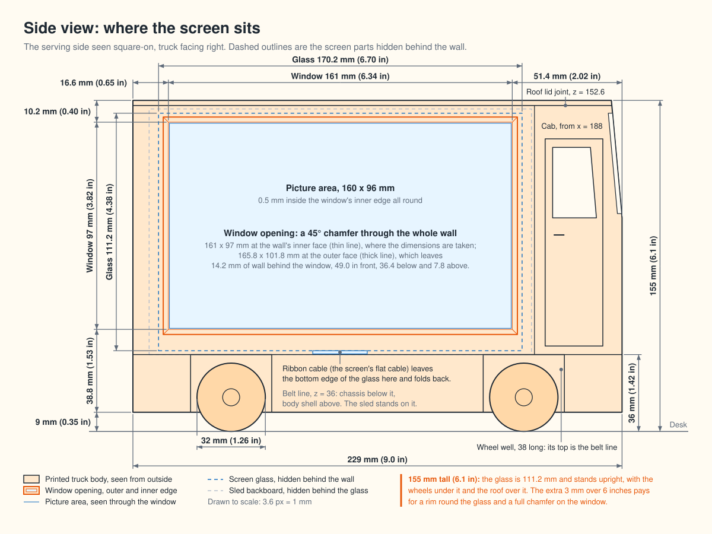

**The truck is 155 mm tall (6.1 in), as you chose.** The screen's glass is 111.2 mm tall and stands upright in
the wall, with the wheels under it and the roof over it. The 3 mm over six inches pays for a rim all round the
glass, a full chamfer on the window, and a stronger wall above it.

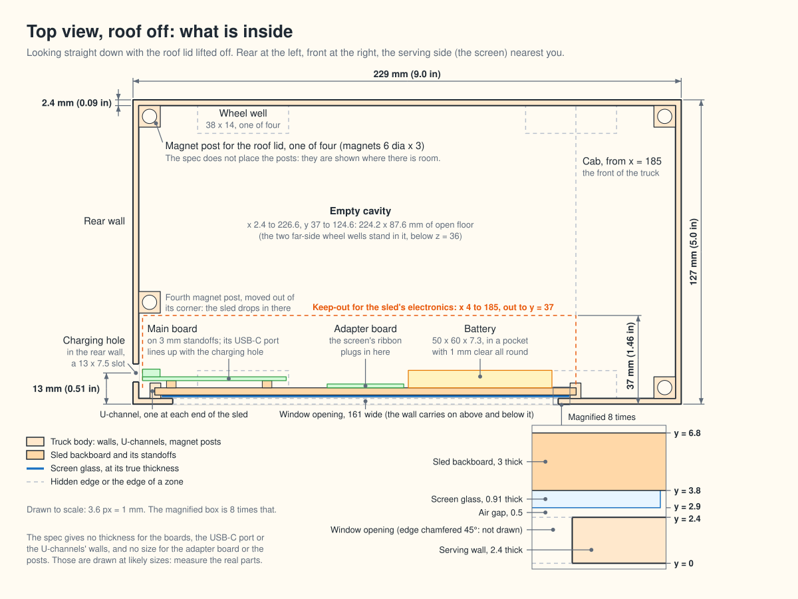

Most of the truck is empty. The electronics take a slab about 38 mm deep behind the serving wall; the rest is yours
for structure, weight or nothing.

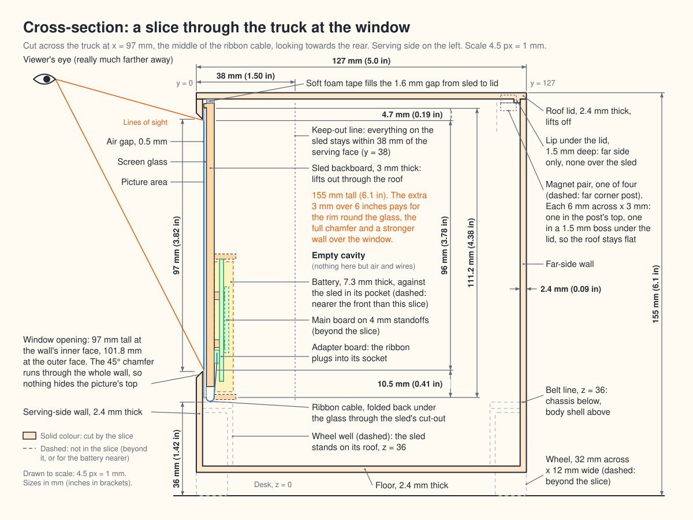

Three rules for the window:

- **The glass never touches the wall.** Leave a 0.5 mm air gap. Nothing clamps or presses the glass.
- **Chamfer the window's edges outward, through the whole wall,** so the wall never shades the picture when you
  look down at it. That makes the opening 165.8 x 101.8 mm on the outside.
- **The opening is 161 x 97 mm at the wall's inner face,** half a millimetre bigger all round than the picture.

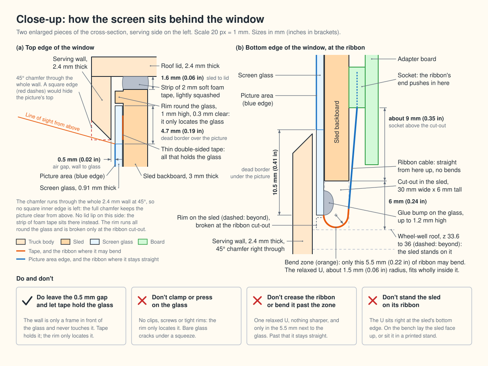

## 7. The sled and the printed parts

Everything electrical lives on one removable printed plate, the **sled**. You build and test it on the bench as a
complete working unit before any truck exists. Then it drops into the truck from the top with the roof off. The
truck is plain plastic: reprint it, repaint it or redesign it without touching the electronics.

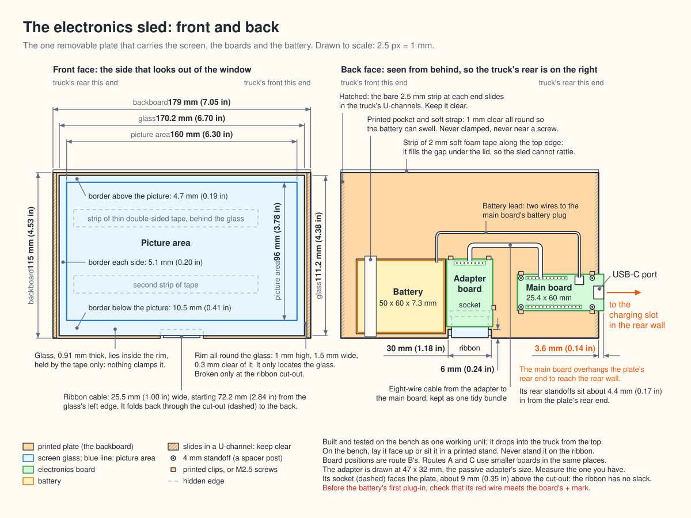

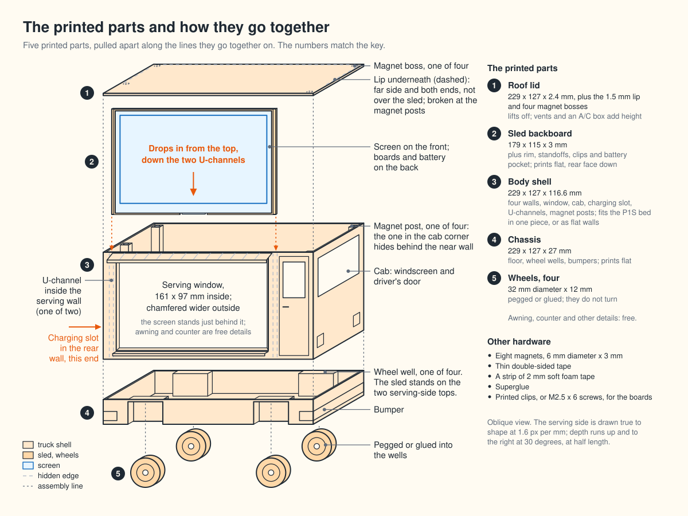

Printing it on your P1S:

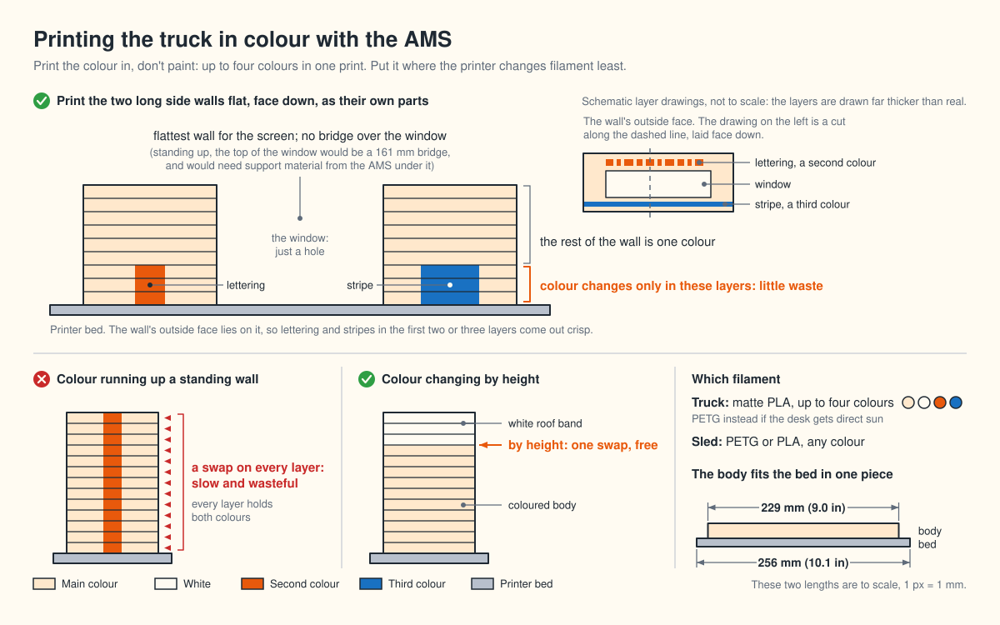

- **It fits.** The body is 229 mm long and your bed is 256 mm, so it prints in one piece.
- **Print the colour in; skip the paint.** The AMS gives you four colours in one print.
- **Print the two long side walls flat, face down, as their own parts.** Lettering and stripes drawn into the first
  two or three layers come out crisp, and the colour only changes in those layers, so little filament is wasted.
  It also gives the flattest wall for the screen and removes the 161 mm bridge over the window. Model a tongue
  and groove where the walls meet the rest of the body, and fix them with a few drops of superglue.
- **Keep other colour changes horizontal.** A stripe running up a standing wall swaps filament on every layer.
- **Material.** Matte PLA for the truck; PETG if the desk gets direct sun. PETG or PLA for the sled.
- **Print a test slice first:** 20 mm of the serving wall with the window and the two channels. Try the sled in it
  before committing to the full print.
- **Charging.** The main board's USB-C port lines up with a slot in the rear wall, so you charge it like a phone,
  roof on. On route A the port may not reach; once a year, lifting the roof to charge is no hardship.

## 8. Shopping list

The electronic parts. Tools are in the next section. Prices are approximate for November 2026; Waveshare's own
site would not load, so its prices are from resellers.

**Every route**

| Part | About |
|---|---|
| 2500 mAh protected LiPo battery with a 2 mm JST plug (Adafruit #328 or similar) | $15 |
| Magnets, 6 mm x 3 mm (you need eight; they come in packs of 50) | $11 |
| Thin double-sided tape (3M 468MP or similar), 2 mm soft foam tape, superglue | $15 |

**Route A**

| Part | About |
|---|---|
| Bare 7.3 inch Spectra 6 panel (Waveshare 7.3inch e-Paper (E), raw panel) | $60 |
| Seeed Studio XIAO ePaper Display Board EE04 (check it ships with its Wi-Fi board already soldered on) | $10 |

**Route B (recommended)**

| Part | About |
|---|---|
| Waveshare 7.3inch e-Paper HAT (E) set: the screen, its adapter and an 8-wire cable | $80 |
| DFRobot FireBeetle 2 ESP32-E | $9 |

**Route C**

| Part | About |
|---|---|
| Bare 7.3 inch Spectra 6 panel | $60 |
| Good Display DESPI-C73 adapter | price not listed |
| Seeed XIAO ESP32-S3 | $7.50 |
| Two 1 MΩ resistors, a slide switch, thin wire | $5 |

A finished unit also exists (Seeed reTerminal E1002, $99: this screen, a battery and a board in a metal case). I do
not recommend it: its case needs a truck about 160 mm tall, and nobody has published its battery life at one
redraw a day.

## 9. Tools: what to buy, what to print

You have few tools and a P1S, so this list buys only what cannot be printed.

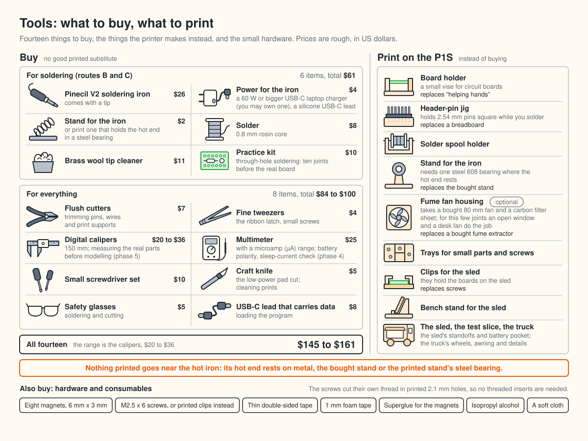

**Buy** (prices read on 12 November 2026 unless marked)

| Tool | My pick | About |
|---|---|---|
| Soldering iron | Pine64 Pinecil V2, from Pine64's store. Comes with a tip, but no power supply. | $26 |
| Power for the iron | Any USB-C laptop charger of 60 W or more (a MacBook charger works), plus Pine64's silicone USB-C lead | $4 |
| Stand for the iron | Pine64's mini stand, or print one (below) | $2 |
| Solder | 63/37 rosin-core, 0.8 mm (0.031 in), from a name brand such as Kester; the smallest pack you can find. Lead-free alternative: SAC305 in the same size (Adafruit #734, out of stock today). | $8 to $30, not checked |
| Brass wool tip cleaner | Hakko brass sponge (Adafruit #1172) | $11 |
| Flush cutters | Hakko CHP-170 (Adafruit #152). Also the best tool for print supports. | $7 |
| Fine tweezers | ESD-safe straight tweezers (Adafruit #421) | $4 |
| Digital calipers, 150 mm | iGaging EZ Cal ($36), or a Neiko 01407A (cheaper; price not checked) | $20 to $36 |
| Multimeter with a microamp range | Aneng AN8008: it reads down to 0.01 µA, so 15 µA shows as 15.00 | about $25, not checked |
| Soldering practice kit | SparkFun WeevilEye (KIT-10723), through-hole | $10 |
| Small screwdrivers, a craft knife, safety glasses, a USB-C lead that carries data | any; solder on a spare ceramic tile or a silicone mat | $28 |

That is **$84 to $100 of tools on any route** (calipers, multimeter, cutters, tweezers, the small things) and
**about $61 more for soldering** (iron, its lead and stand, solder, cleaner, practice kit). If the multimeter sounds
dull: it is the one tool that tells you the battery will last a year before you seal the truck, and it stops you
plugging a battery in backwards.

**Print** (all free on MakerWorld; download counts show they are well used)

| Print | Model | Notes |
|---|---|---|
| Board holder, in place of "helping hands" | [Adjustable PCB Holder Tool](https://makerworld.com/en/models/159336) by squinn, 12,800 downloads | fully printed, no hardware |
| Header-pin jig | [Soldering Assistant V2: Modular Sliding-Pin Jig](https://makerworld.com/en/models/2836264) by ASF94, 2,000 downloads | holds 2.54 mm pins square while you solder |
| Solder spool holder | [Soldering wire holder](https://makerworld.com/en/models/194888) by 3Deste, 9,500 downloads | |
| Stand for the Pinecil | [Pinecil Soldering Iron Stand](https://makerworld.com/en/models/1177626) by Daniel Jovanovic, 1,300 downloads | needs one steel 608 bearing where the hot end rests; print in PETG. Or buy the $2 stand. |
| Parts and screw trays | [Stackable Screw Tray Box system](https://makerworld.com/en/models/54727) by Meister Edel, 2,800 downloads | |
| Fume fan (optional) | [Soldering Fume Extractor, USB-C, Filter Tray](https://makerworld.com/en/models/457455) by LTS Design, 3,300 downloads | needs an 80 mm fan, a carbon filter sheet and a little soldering: a good second project. For this few joints, an open window and a desk fan do the job. |
| The sled, its bench stand, the test slice, the truck | yours | |

Two screen frames worth downloading only to look at, since they hold this exact panel:
[Waveshare 7.3" display frame](https://makerworld.com/en/models/1924771) by beo, and
[WaveShare 7.3 frame](https://makerworld.com/en/models/1213404) by Delomixal, whose author warns that some panels
differ from Waveshare's stated size. That is why phase 5 starts with calipers.

**Print rather than buy, inside the truck too:**

- **Clips in place of screws.** Model snap clips or pegs on the sled to hold the boards, and you need no screws at
  all. I could not find M2.5 self-tapping screws in a small pack anyway; an assortment box of M2.5 machine screws
  (about $8, not checked) works in 2.1 mm printed holes if you would rather screw.
- **Standoffs, the battery pocket and its strap** are part of the sled print.
- **Magnets cannot be printed.** Eight 6 x 3 mm discs; a 50-pack is about $11.
- **Nothing printed goes near the hot iron.** PLA softens at about 60 °C.

## 10. Learning to solder

For routes B and C. Do the practice kit first; the real board comes after ten joints you are happy with.

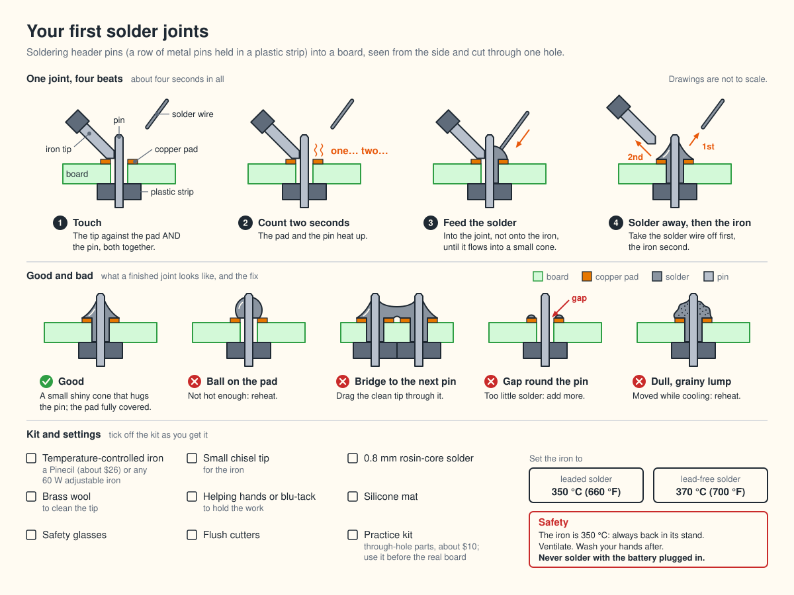

- **Hold the pins square** in the printed header-pin jig before you solder the board onto them.
- **Solder one corner pin, check the board sits flat, then do the rest.**
- **Never solder with the battery plugged in.**

## 11. The build, in order

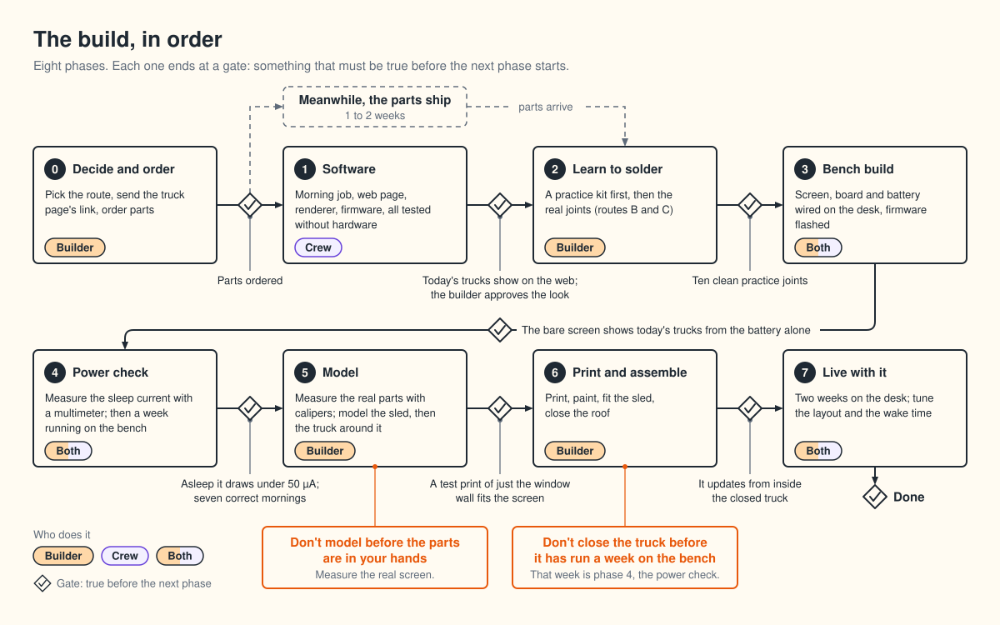

Two rules of order: **don't model before the parts are in your hands**, and **don't close the truck before it has
run a week on the bench**.

**Phase 0. Decide and order (you).**
1. Done: you chose route B, the 7.3 inch screen and 155 mm, and gave the truck page's link.
2. Check the office Wi-Fi has a 2.4 GHz band (these boards cannot use 5 GHz), and that a home-made gadget is
   allowed on it. A quick word with whoever runs the network settles both.
3. Order the parts for route B (section 8) and the tools (section 9).

**Phase 1. Software (the crew, while your parts ship).**
1. The job that reads the truck page and picks out today's trucks.
2. The web page, laid out for the screen.
3. The renderer: page to screenshot to six-colour picture.
4. The morning schedule, publishing to a fixed web address.
5. The program for your route's board.
Gate: today's trucks show at the web address, and you approve the look on Review Desk.

**Phase 2. Learn to solder (you; routes B and C).**
1. Build the practice kit. Aim for ten clean joints.
2. Solder the two rows of header pins onto the FireBeetle.
3. Cut the low-power pad with a craft knife (it is marked on the board; I will show you exactly where).

**Phase 3. Bench build (you, with me on call).**
1. Lay the parts out on the desk. Leave the screen's protective film on.
2. Plug the screen's ribbon into the adapter: lift the socket's latch, slide the ribbon in square, close the latch.
   Never with power connected.
3. Connect the eight wires by the pin map.
4. Check the battery's polarity with the multimeter, then plug it in.
5. Load the program over USB-C (one command, which I will give you) and enter the Wi-Fi name and password.
Gate: the bare screen shows today's trucks, running from the battery alone.

**Phase 4. Power check (both).**
1. With the multimeter in line with the battery, read the current while the truck sleeps. Expect about 15 µA
   (0.015 mA). Hundreds of µA means something is still awake; we find it before going on.
2. Leave it running on the bench for a week. It redraws every morning.
Gate: sleep current under 50 µA, and seven mornings of correct pictures.

**Phase 5. Model (you).**
1. Measure the real screen, boards and battery with calipers.
2. Model and print the sled. Mount the electronics on it. It should work exactly as it did loose on the bench.
3. Model the truck around the sled, to the numbers in section 6. Print the tools from section 9 while you wait for parts.
4. Print the test slice of the serving wall and try the sled in it.

**Phase 6. Print and assemble (you).**
1. Print the chassis, body, roof and wheels, with the colour printed in.
2. Drop the sled in, peel the screen's film, put the roof on.
Gate: it updates from inside the closed truck, on the desk where it will live.

**Phase 7. Live with it (both).** Two weeks on the desk. We tune the layout, the wake time and anything that
annoys you.

## 12. What could go wrong

| Risk | What we do about it |
|---|---|
| The office Wi-Fi has no 2.4 GHz band, or does not allow gadgets | Checked in phase 0, before you buy anything. |
| The truck page changes its layout and the job cannot read it | The screen says so plainly instead of showing old trucks, and GitHub emails me that the job failed. |
| The cloud job runs late (GitHub's schedule can slip by half an hour) | The truck checks the picture's date; if it is yesterday's, it tries again in 30 minutes. |
| Battery life is shorter than estimated | Measured in phase 4 while everything is still on the bench. The fixes are known: the low-power pad, or a passive adapter for the screen. |
| The glass cracks | Nothing clamps it, the film stays on until the end, and the sled keeps it supported from the bench to the truck. |
| Faint ghost images after a weekend | The screen's maker advises a redraw every 24 hours; weekends go 72. If ghosts appear, the truck redraws at weekends too, which costs about five weeks of battery life per charge. |
| Sun and heat | Keep it out of direct sun: the screen degrades in it and PLA softens. The screen works from 0 to 50 °C. |
| The battery | A protected cell in a pocket with room to swell, never clamped, away from screw points. Charge it while you are around. |
| Parts turn out different from the datasheet | You measure the real parts before modelling, and print a test slice before the full truck. |

## 13. What is decided, and what is still open

Decided on 12 November 2026:

- Build route B: a little soldering.
- The 7.3 inch screen.
- A truck 155 mm (6.1 in) tall.
- The truck list is Off the Grid's page for Levi's Plaza: `offthegrid.com/event/levis-plaza`.
- A GitHub repo for the job and the page: created, private.
- The page's design gets real work later, once the hardware runs.

Still open:

- **Public repo or other hosting** for the three small files, when the software is ready.
- **Two facts nobody publishes,** each settled on the bench: the energy one redraw costs on this screen, and
  whether Waveshare's adapter draws current while asleep.
- **Three sizes only the real parts give:** where the FireBeetle's battery socket faces, the size of Waveshare's
  adapter board, and the glass's true size.
